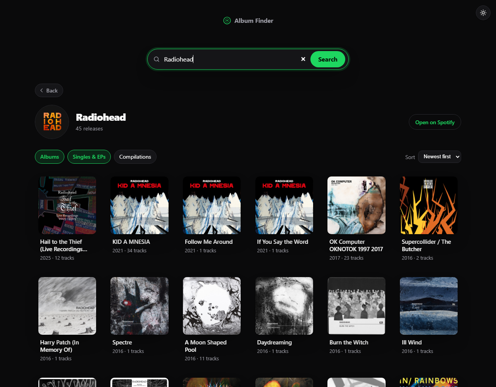

<div align="center">

# Album Finder

**Search any artist and browse their full discography: cover art, release types, tracklists, and links to Spotify.**

[](https://albumfinder-app.vercel.app)

<br />



</div>

---

Album Finder is a React 18 + Vite frontend with a small Express backend. The
backend does the Spotify token exchange, so your API secret never reaches the
browser. It runs locally as one command and deploys to Vercel with no extra
configuration.

## Features

- **Artist search.** Type a name and get the top matching artist, their photo,
  and their releases in one request. Suggestion chips (Radiohead, Kendrick
  Lamar, Daft Punk, and more) fill the empty state.
- **Release filters.** Toggle Albums, Singles & EPs, and Compilations
  independently. At least one type always stays selected.
- **Sorting.** Newest first, oldest first, or title A to Z.
- **Album detail.** Click a release for its full tracklist with track
  numbers (disc-aware for multi-disc albums), durations, explicit tags,
  per-track Spotify links, label, and year. Close it with `Esc` or by
  clicking the backdrop.
- **Light and dark mode.** Follows your OS setting, and a button in the
  top-right corner lets you override it. Your choice is saved in the browser
  and applied before the page paints, so there is no flash on reload.
- **Shareable URLs.** A search sets `?q=` in the address bar, so you can
  bookmark or share results.
- **Loading, empty, and error states.** Skeleton cards while fetching, a
  message when nothing matches, and a retry button when a request fails.
- **Accessible and responsive.** Fluid album grid, keyboard-navigable
  controls, `aria` labels, and reduced-motion support.
- **Resilient backend.** Caches the Spotify token and recent results in
  memory, retries once on `429` (respecting `Retry-After`), paginates artist
  albums and tracklists, and removes duplicate releases.

## Tech stack

| Layer    | Stack                                                                    |
| -------- | ------------------------------------------------------------------------ |
| Frontend | React 18, Vite 5, plain CSS with variables for theming                   |
| Backend  | Node.js, Express, Spotify Client Credentials flow                        |
| Data     | [Spotify Web API](https://developer.spotify.com/documentation/web-api)   |
| Tooling  | ESLint (`eslint:recommended` plus React and Hooks rules), Concurrently   |

## Getting started

You need Node.js 18 or newer (the server uses the built-in `fetch`) and a free
Spotify developer account.

1. **Install dependencies**

   ```bash
   npm install
   ```

2. **Add Spotify credentials.** Create an app in the
   [Spotify Developer Dashboard](https://developer.spotify.com/dashboard), then
   copy the template and fill in your values:

   ```bash
   cp .env.example .env
   ```

   ```env
   SPOTIFY_CLIENT_ID=your_client_id
   SPOTIFY_CLIENT_SECRET=your_client_secret
   ```

   `.env` is gitignored. The server uses the Client Credentials flow, so no
   user login or redirect URI is needed.

3. **Run it**

   ```bash
   npm run dev
   ```

   This starts the API on `localhost:3001` and the Vite dev server together.
   Open the URL Vite prints (default <http://localhost:5173>). Vite proxies
   `/api/*` to the API for you.

## Scripts

| Script               | Purpose                                 |
| -------------------- | --------------------------------------- |
| `npm run dev`        | API and client together, with hot reload |
| `npm run dev:client` | Vite dev server only                    |
| `npm run dev:server` | API server only (`node --watch`)        |
| `npm run build`      | Production client build to `dist/`      |
| `npm start`          | Run the API server (production)         |
| `npm run lint`       | ESLint over the whole project           |

## API

The Express server exposes a small JSON API used by the React app.

| Endpoint                                    | Description |
| ------------------------------------------- | ----------- |
| `GET /api/health`                           | `{ ok, spotifyConfigured }`. Checks that credentials are set. |
| `GET /api/search?q=<artist>&groups=<types>` | Finds the best-matching artist for `q` and returns their releases. `groups` is a comma-separated subset of `album,single,compilation,appears_on` and defaults to `album,single`. Response: `{ artist, groups, albums[] }`. |
| `GET /api/album/:id`                        | Full detail for one album, including the complete tracklist. |

Results are cached in memory for 10 minutes per query, and a `429` from
Spotify is retried once before the error reaches the client.

## Project structure

```
Album Finder/
├─ api/
│  └─ index.js        Vercel serverless entry (wraps server/app.js)
├─ docs/
│  └─ screenshot.png  README screenshot
├─ server/
│  ├─ app.js          Express app and all /api routes (shared by both entry points)
│  ├─ index.js        Local and single-service entry: app.js + static dist/ + listen()
│  ├─ spotify.js      Spotify client: auth, search, albums, caching
│  └─ load-env.js     Minimal .env loader (no extra dependency)
├─ src/
│  ├─ App.jsx         UI: search, filters, sort, grid, album modal, theme toggle
│  ├─ App.css         Component styles
│  ├─ index.css       Theme tokens (light and dark) and resets
│  └─ main.jsx        React entry point
├─ public/            Static assets (favicon)
├─ index.html         Also applies the saved theme before first paint
├─ vite.config.js     Dev server and /api proxy
├─ vercel.json        Routes /api/* to the serverless function
└─ .env.example
```

## Deploying

The API routes live in [`server/app.js`](server/app.js) and are shared by two
entry points, so the same backend code runs on either platform.

### Vercel

1. Import the repo at [vercel.com/new](https://vercel.com/new). The Vite
   frontend is detected and built to `dist/`, and
   [`api/index.js`](api/index.js) deploys as a serverless function.
   [`vercel.json`](vercel.json) rewrites every `/api/*` request to it.
2. Under **Settings, Environment Variables**, add `SPOTIFY_CLIENT_ID` and
   `SPOTIFY_CLIENT_SECRET`.
3. Deploy.

On Vercel the in-memory token and result cache only last while a function
instance stays warm, so you will see fewer cache hits than on a long-running
server.

### Render, Railway, or any Node host

1. **Build command:** `npm install && npm run build`
2. **Start command:** `npm start`. This runs [`server/index.js`](server/index.js),
   which serves the built `dist/` folder and the API from one process on
   `PORT` (default `3001`).
3. Set `SPOTIFY_CLIENT_ID` and `SPOTIFY_CLIENT_SECRET` as real environment
   variables. The `.env` loader is skipped when the file doesn't exist.

## License

[MIT](LICENSE) © Mazhar Sourav
